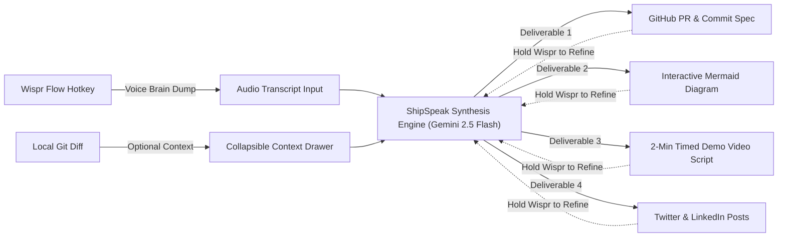

# ShipSpeak 🚢🎙️
> **The voice-first last-mile shipping engine for developers and hackathon builders.**  
> Built for the **WeMakeDevs No Hands Challenge**, sponsored by **Wispr Flow**.

[](https://github.com/AsteroidHH/Wispr-Flow-No-Hands-Challenge)
[](https://nextjs.org/)
[](https://ai.google.dev/)
[](https://www.typescriptlang.org/)
[](https://tailwindcss.com/)

---

## 💡 The Problem
Developers spend 36–48 hours building incredible code at hackathons, but shipping creates massive cognitive drag:
- Writing pull request descriptions with breaking changes
- Drawing system architecture diagrams in Figma or Excalidraw
- Scripting 2-minute timed demo video pitches with visual cues
- Drafting technical build-in-public posts for Twitter and LinkedIn

When builders dump code into generic LLMs, the output is hallucinated and generic because it lacks the developer's raw rationale and mental context.

---

## ⚡ The Solution: ShipSpeak
**ShipSpeak** transforms an unstructured, messy 45-second voice brain dump (captured via the **Wispr Flow hotkey**) and an optional `git diff` into four structured, developer-grade deliverables in real-time.



---

## 🚀 Key Features

### 1. Input Control Center & Audio HUD
- **3 One-Click Judge Presets:**
  - 🛡️ **Auth Refactor:** OAuth2 PKCE, edge JWT verification, Redis token revocation.
  - 🤖 **AI Agent Pipeline:** Multi-agent supervisor, SQL/Vector routing, 0.72 confidence circuit breaker.
  - 🏆 **Hackathon Project:** ShipSpeak voice-first shipping cockpit.
- **Live Audio-Reactive HUD:** Built with Web Audio API (`AudioContext` + `AnalyserNode`) rendering 24 real-time equalizer bars and a dynamic indigo/cyan ambient aura around the textarea when speaking.
- **Persistent Wispr Indicator:** *"Press your Wispr Flow hotkey and ramble here"* with simulated voice testing and word counter.
- **Collapsible Git Diff Drawer:** Line-counted secondary context ingestion for maximum grounding.
- **Trigger Button & Keyboard Shortcut:** `⌘ + Enter` / `Ctrl + Enter` instant synthesis.

### 2. Real-Time 4-Card Bento Grid
1. **GitHub PR & Commit Card:**
   - Conventional commit message, executive summary, bulleted key changes, and breaking change alert box.
   - **Zero-OAuth "Open on GitHub" PR Launcher:** Generates a pre-filled GitHub compare URL with title and body query parameters.
   - **ZIP Bundle Export:** One-click download of all release artifacts.
2. **Mermaid Architecture Card:**
   - Dynamic SVG rendering with isolated GUID passes.
   - **PNG Export:** Canvas serialization at 2x retina resolution with `#090d16` background.
   - **SVG Export:** Raw vector markup download.
   - **Fullscreen Modal & Zoom:** Scale from 40% to 220% with reset controls.
   - **Dynamic Theming:** Instant toggling between Obsidian Dark, Cyberpunk Indigo, and Slate Minimal palettes.
3. **2-Minute Demo Video Script Card:** Time-bucketed segments (`00:00 - 00:20`, `00:20 - 00:50`, etc.) with spoken dialogue lines and screen recording cues.
4. **Build-in-Public Social Card:** Tabbed preview for formatted launch post, Twitter thread (character progress bar + hashtags), and LinkedIn breakdown.

### 3. Voice Tweak Refinement Loop
- Every single card features a dedicated bottom refinement bar: **"Hold Wispr to refine this card."**
- Allows hands-free iterative changes like *"make the PR more concise"* or *"add a Redis note to the architecture diagram"*.
- Targeted card enters an animated violet glowing focus ring and updates in-place smoothly without re-rendering adjacent cards.

### 4. Interactive Terminal CLI Drawer
- macOS style window controls (traffic lights) with dark developer console.
- Interactive prompt simulating `shipspeak --listen` with realistic animated pipeline logs.
- 1-click copy for the hypothetical CLI command: `npx shipspeak --voice`.

### 5. Zero-Friction Judge Experience
- Boots pre-populated with high-fidelity mock data.
- Resilient two-tier fallback: if `GEMINI_API_KEY` is not provided, both `/api/generate` and `/api/tweak` gracefully synthesize high-quality mock deliverables so judges never face broken screens or authentication errors.

---

## 🛠️ Architecture & Tech Stack

- **Frontend:** Next.js 16 (App Router with Turbopack), React 19, TypeScript, Tailwind CSS v4.
- **Diagramming:** Client-side `mermaid` (v12.2.0) with isolated GUID render passes and dark theme palette.
- **AI Engine:** Official Google Gen AI SDK (`@google/genai`) with `gemini-2.5-flash` structured JSON schema enforcement.
- **Archiving:** `jszip` for client-side bundle generation (`ShipSpeak-deliverables.zip`).
- **Endpoints:**
  - `POST /api/generate`: Synthesizes PR markdown, commit title, valid Mermaid syntax, video script array, and social post.
  - `POST /api/tweak` (and alias `/api/week`): Refines specific card schemas in-place based on voice prompts.

---

## 💻 Getting Started

### Prerequisites
- Node.js 18+ (tested on Node v24)
- npm / pnpm / yarn

### Installation
```bash
# Clone the repository
git clone https://github.com/AsteroidHH/Wispr-Flow-No-Hands-Challenge.git
cd Wispr-Flow-No-Hands-Challenge

# Install dependencies
npm install

# (Optional) Add your Gemini API key in .env.local
# If omitted, ShipSpeak automatically runs in zero-friction mock evaluation mode
echo "GEMINI_API_KEY=your_key_here" > .env.local

# Start development server
npm run dev
```

Visit [http://localhost:3000](http://localhost:3000) to open the cockpit.

---

## 📜 License
MIT License. Built with ❤️ for the **WeMakeDevs No Hands Challenge** sponsored by **Wispr Flow**.
